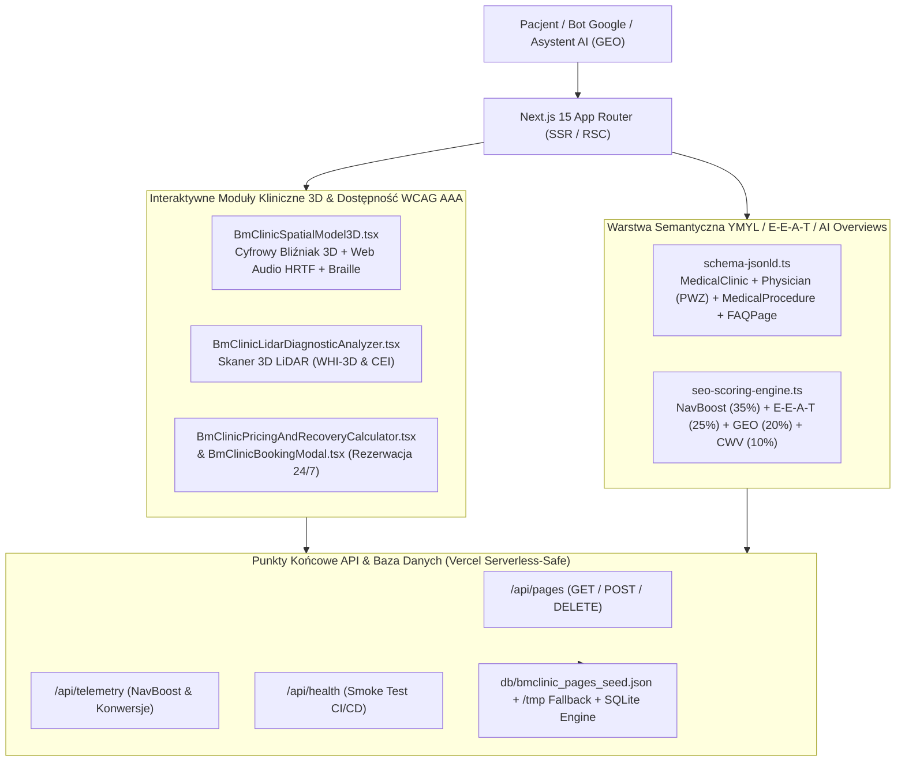

# BM Clinic (`bmclinic.co`) — Platforma Medyczna Next.js 15, Cyfrowy Bliźniak 3D, Nawigacja HRTF dla Niewidomych i Silnik AI SEO

[](https://nextjs.org/)
[](https://react.dev/)
[](https://www.typescriptlang.org/)
[](#3-cyfrowy-bliźniak-3d-kliniki--nawigacja-dla-osób-niewidomych-vi-wayfinding)
[](#5-silnik-ai-seo--conversion-intelligence-ymyl--e-e-a-t)
[](#7-uruchomienie-lokalne-i-wdrożenie-na-vercel-staged-production)

Kompletna, flagowa platforma medyczna **Next.js 15 (App Router, React 19, TypeScript, Tailwind CSS)** stworzona dla **BM Clinic (`bmclinic.co` — Klinika Chirurgii Małoinwazyjnej, Flebologii, Proktologii i Medycyny Estetycznej)**. Projekt łączy architekturę **Medical SEO / Generative Engine Optimization (GEO / Google AI Overviews)** z interaktywnym **Cyfrowym Bliźniakiem 3D kliniki**, nawigacją dźwiękową **3D Web Audio HRTF dla pacjentów niewidomych i słabowidzących** oraz **6-parametrowym analizatorem diagnostycznym 3D LiDAR**.

---

## Spis Treści

1. [Architektura Systemu](#1-architektura-systemu)
2. [Działy Zabiegowe i Podstrony Procedur Medycznych](#2-działy-zabiegowe-i-podstrony-procedur-medycznych)
3. [Cyfrowy Bliźniak 3D Kliniki & Nawigacja dla Osób Niewidomych (VI Wayfinding)](#3-cyfrowy-bliźniak-3d-kliniki--nawigacja-dla-osób-niewidomych-vi-wayfinding)
4. [Skaner Diagnostyczny 3D LiDAR (6 Parametrów Klinicznych)](#4-skaner-diagnostyczny-3d-lidar-6-parametrów-klinicznych)
5. [Silnik AI SEO & Conversion Intelligence (YMYL / E-E-A-T)](#5-silnik-ai-seo--conversion-intelligence-ymyl--e-e-a-t)
6. [Struktura Katalogów i Punkty Końcowe API](#6-struktura-katalogów-i-punkty-końcowe-api)
7. [Uruchomienie Lokalne i Wdrożenie na Vercel (Staged Production)](#7-uruchomienie-lokalne-i-wdrożenie-na-vercel-staged-production)

---

## 1. Architektura Systemu



---

## 2. Działy Zabiegowe i Podstrony Procedur Medycznych

Każdy dział kliniki posiada dedykowany hub (`/[department]`), przypisany gabinet zabiegowy w modelu 3D, tabliczkę w alfabecie **Braille’a (Unicode)** oraz indywidualną częstotliwość akustycznego **beacona przestrzennego HRTF**:

| Dział Kliniki | Ścieżka URL | Gabinet | Kod Braille’a | Częstotliwość Beacona HRTF | Główne Procedury (`/procedury/[slug]`) |
| :--- | :--- | :---: | :---: | :---: | :--- |
| **Medycyna Estetyczna** | `/medycyna-estetyczna` | `GAB-101` | `⠃⠍⠁⠚⠁` | `528 Hz` | Laser Frakcyjny CO₂ / Er:YAG Resurfacing 3D, Wolumetria i Stymulatory Tkankowe |
| **Flebologia** | `/flebologia` | `GAB-102` | `⠃⠍⠁⠚⠃` | `594 Hz` | Wewnątrzżylna Ablacja Laserowa Żylaków **EVLT 1470 nm**, Skleroterapia Piankowa pod USG Doppler |
| **Proktologia** | `/proktologia` | `GAB-103` | `⠃⠍⠁⠚⠉` | `660 Hz` | Laserowa Hemoroidektomia **LHP 1470 nm**, Laserowe Zamknięcie Przetoki **FiLaC / SiLaC** |
| **Chirurgia Ogólna** | `/chirurgia-ogolna` | `GAB-104` | `⠃⠍⠁⠚⠙` | `792 Hz` | Radiochirurgiczne Usuwanie Zmian Skórnych (RF 4.0 MHz), Plastyka Wałów Paznokciowych |

Każda z **8 podstron procedur medycznych (`/procedury/[slug]`)** zawiera:
- **Samodzielny blok odpowiedzi bezpośredniej (130–170 słów)** zoptymalizowany pod cytowania **Google AI Overviews (GEO)** oraz LLM,
- Weryfikację lekarza prowadzącego z numerem **PWZ (Prawo Wykonywania Zawodu — sygnał E-E-A-T / YMYL)**,
- Porównanie metody laserowej vs klasycznej operacji chirurgicznej, parametry kliniczne i pełny graf **Schema.org JSON-LD**.

---

## 3. Cyfrowy Bliźniak 3D Kliniki & Nawigacja dla Osób Niewidomych (VI Wayfinding)

Moduł `src/components/BmClinicSpatialModel3D.tsx` udostępnia interaktywną makietę 3D kliniki zaprojektowaną w standardzie **WCAG 2.1 AAA**:
- **2 tryby kamery**: rzut izometryczny 3D całej kliniki oraz widok pierwszoosobowy (**1st-Person POV**) z perspektywy pacjenta idącego ścieżką prowadzącą (*Tactile Paving*),
- **Dźwięk przestrzenny 3D Web Audio API (`PannerNode` HRTF)**: syntetyzowane w czasie rzeczywistym beacony akustyczne lokalizujące wybrany gabinet w przestrzeni trójwymiarowej,
- **Orientacja zegarowa (godziny 1–12)** oraz natywna polska synteza mowy **Web Speech API (`pl-PL`)** prowadząca pacjenta krok po kroku od wejścia i recepcji do wybranego gabinetu,
- **Tryb Wysokiego Kontrastu VI (WCAG AAA)** przełączający całą aplikację w kontrastowy schemat czarno-żółto-cyjanowy.

---

## 4. Skaner Diagnostyczny 3D LiDAR (6 Parametrów Klinicznych)

Moduł `src/components/BmClinicLidarDiagnosticAnalyzer.tsx` pozwala na symulację oraz analizę 6 parametrów tkankowych przed i po zabiegu:
1. Głębokość zmiany / niewydolności naczyniowej (`mm`),
2. Gradient perfuzji mikrokrążenia (`%`),
3. Indeks obrzęku okołotkankowego (`%`),
4. Asymetria termiczna w podczerwieni (`Δ°C`),
5. Gęstość macierzy kolagenowej (`%`),
6. Szacowany czas pełnej regeneracji (`dni`).

Na podstawie pomiarów algorytm wylicza syntetyczne indeksy **WHI-3D (*Wound & Tissue Healing Index*)** oraz **CEI (*Clinical Efficacy Index*)**, generuje siatkę punktową 3D LiDAR, 6-osiowy wykres radarowy oraz umożliwia eksport rekordu diagnostycznego do pliku **JSON (`PAC-2026-0419`)**.

---

## 5. Silnik AI SEO & Conversion Intelligence (YMYL / E-E-A-T)

Silnik `src/lib/seo-scoring-engine.ts` oraz `bmclinic_db_engine.py` ocenia każdą podstronę kliniki w skali `0–100` oraz wylicza sygnał nagrody **Reinforcement Learning (`Agent Reward Signal 0.000–1.000`)** dla Agenta AI:

$$\text{Composite SEO Score} = 0.35 \cdot \text{NavBoost} + 0.25 \cdot \text{E-E-A-T} + 0.20 \cdot \text{GEO/AIO} + 0.10 \cdot \text{CWV} + 0.10 \cdot \text{DomainArch}$$

- **NavBoost (`35%`)**: stosunek `goodClicks` do `badClicks`, `lastLongestClicks` oraz średni czas zaangażowania (`avgDwellTimeSec`),
- **E-E-A-T / YMYL (`25%`)**: weryfikacja lekarza PWZ, liczba cytowań klinicznych PubMed/PTF, autorskie multimedia 3D oraz `effortScore`,
- **AI Overviews / GEO (`20%`)**: optymalna długość bloku odpowiedzi bezpośredniej (`130–170 słów`), zagęszczenie encji medycznych oraz kompletność grafu `Schema.org JSON-LD`,
- **Core Web Vitals (`10%`)**: `LCP <= 2500 ms`, `INP <= 200 ms`, `CLS <= 0.10`,
- **Architektura Domeny (`10%`)**: głębokość kliknięć od strony głównej (`clickDepth <= 2`) oraz spójność tematyczna (`siteFocusScore`).

---

## 6. Struktura Katalogów i Punkty Końcowe API

```text
bmclinic.co/
├── db/
│   ├── bmclinic_pages_seed.json        # Ziarno bazy podstron dla środowiska serverless (Vercel)
│   └── bmclinic_production.sqlite      # Lokalna baza SQLite z wynikami SEO i telemetrią
├── scripts/
│   └── vercel-build-before-publish.sh  # Skrypt budowania Staged Production (--skip-domain)
├── src/
│   ├── app/
│   │   ├── [department]/page.tsx       # Huby 4 działów medycznych kliniki
│   │   ├── procedury/[slug]/page.tsx   # 8 podstron procedur z blokami GEO i Schema.org
│   │   ├── api/health/route.ts         # GET /api/health — diagnostyka i Smoke Test
│   │   ├── api/pages/route.ts          # GET / POST / DELETE /api/pages — generator blueprintów AI
│   │   ├── api/telemetry/route.ts      # GET / POST /api/telemetry — zliczanie konwersji i NavBoost
│   │   ├── manifest.ts                 # Web App Manifest (PWA)
│   │   ├── opengraph-image.tsx         # Dynamiczna karta OpenGraph 1200x630 (Edge)
│   │   ├── robots.ts                   # Konfiguracja crawlerów + botów AI (GPTBot, Google-Extended)
│   │   ├── sitemap.ts                  # Automatyczna mapa strony XML
│   │   └── page.tsx                    # Strona główna kliniki z modułami 3D i nawigacją VI
│   ├── components/
│   │   ├── BmClinicSpatialModel3D.tsx              # Cyfrowy Bliźniak 3D + HRTF Audio + Braille
│   │   ├── BmClinicLidarDiagnosticAnalyzer.tsx     # 6-parametrowy skaner 3D LiDAR (WHI-3D / CEI)
│   │   ├── BmClinicPricingAndRecoveryCalculator.tsx# Kalkulator kosztów i rekonwalescencji
│   │   ├── BmClinicBookingModal.tsx                # Modal rezerwacji wizyty online 24/7
│   │   └── BmClinicMobileTransitionShell.tsx       # Płynna nawigacja mobilna i pasek dolny
│   └── lib/
│       ├── clinic-departments-data.ts  # Dane kliniczne 4 działów i 8 procedur zabiegowych
│       ├── schema-jsonld.ts            # Generator grafów Schema.org JSON-LD
│       └── seo-scoring-engine.ts       # Algorytm oceny SEO, NavBoost i RL Reward Signal
├── bmclinic_db_engine.py               # Generator i inicjalizator bazy SQLite + JSON seed
└── vercel.json                         # Konfiguracja nagłówków bezpieczeństwa i regionu (fra1)
```

---

## 7. Uruchomienie Lokalne i Wdrożenie na Vercel (Staged Production)

### Uruchomienie lokalne

```bash
# 1. Instalacja zależności Node.js (wymagany Node >= 20)
npm install

# 2. (Opcjonalnie) Odświeżenie bazy SQLite i pliku seed JSON
npm run db:init

# 3. Uruchomienie serwera deweloperskiego Next.js 15
npm run dev
```

Aplikacja będzie dostępna pod adresem `http://localhost:3000`.

### Wdrożenie na Vercel (Staged Production przed przypięciem domeny `bmclinic.co`)

```bash
# Sposób 1: Skrypt automatyczny (buduje, wdraża z --skip-domain i wykonuje Smoke Test /api/health)
./scripts/vercel-build-before-publish.sh

# Sposób 2: Krok po kroku przez Vercel CLI
vercel build --prod
STAGED_URL=$(vercel deploy --prebuilt --prod --skip-domain)

# Weryfikacja buildu przed publikacją na domenie głównej
curl -s "$STAGED_URL/api/health" | jq .

# Promocja zweryfikowanego buildu na domenę bmclinic.co
vercel promote "$STAGED_URL"
```

---

## Licencja i Informacje Prawne

Projekt przygotowany dla **BM Clinic (`bmclinic.co`)**. Wszystkie opisy procedur medycznych pełnią funkcję informacyjno-edukacyjną zgodną ze standardami **YMYL / E-E-A-T** i nie zastępują indywidualnej konsultacji lekarskiej.
